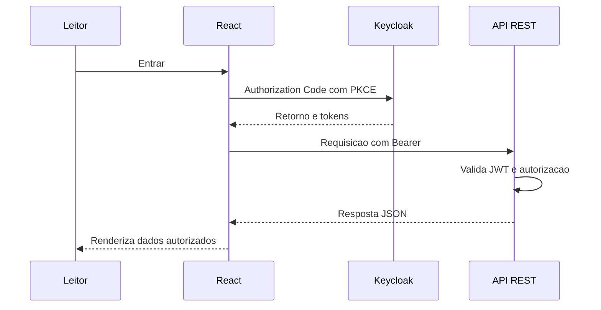

# Contexto técnico — frontend-design-css

Trechos temáticos do README da main. Confira o código e o README vigente se o contrato tiver mudado.

## Edição acadêmica CEUB

A branch `feature/identidade-ceub` conserva a navegação, a integração com as três APIs e os controles de acessibilidade. A identidade usa roxo, magenta e o logo fornecido para o projeto. A revisão de portfólio permanece em `feature/administracao-usuarios` (`5ac7b90`).

- Tailwind CSS 4: integração pelo plugin oficial do Vite, com classes utilitárias de layout, grade de livros e espaçamento; sem Preflight.
- Materialize CSS 2: botões preenchidos, contornados e tonais, cartões e tokens visuais. Seu CSS fica numa camada própria; os formulários, os diálogos acessíveis e os eventos continuam controlados pelo React.
- CSS do projeto: identidade CEUB, paleta, contraste, estilização das telas e adaptações responsivas. Sem Bootstrap.

O tema separado do Keycloak está em `keycloak-theme/`. Empacote o diretório como JAR mantendo `META-INF/keycloak-themes.json` e `theme/bibliogest-ceub` na raiz e disponibilize-o em `/opt/keycloak/providers/`. Depois de reiniciar o Keycloak, selecione **Realm settings → Themes → Login theme → bibliogest-ceub**. O tema original `bibliogest` permanece disponível. O novo tema altera apenas CSS e recursos de apresentação; herda os formulários e o fluxo de autenticação de `keycloak.v2`.

O fluxo de CI continua executando lint, Vitest com mínimo de 80% em todas as métricas, Cypress (incluindo verificações de acessibilidade) e build.

## Organização do frontend

| Tecnologia / arquivo | Função |
| --- | --- |
| React 19, JavaScript, Vite | Componentes e estado, build estático |
| Tailwind CSS 4 e Materialize CSS 2 | Layout responsivo e estilo dos componentes; CSS próprio para identidade CEUB |
| src/App.jsx, src/components/ | Áreas autenticadas, formulários, modais, catálogo e administração |
| src/domain/ | Transformação de dados de catálogo e reservas |
| src/auth.js, src/hooks/useSession.js | Sessão, autorização de apresentação, renovação e envio do token |
| public/config.json, config.dev.json | Configuração pública por ambiente |
| src/index.css, App.css, frameworks.css | Paleta, temas, acessibilidade e integração entre frameworks CSS |
| keycloak-theme/ | Tema de login independente, empacotado em JAR |
| nginx.conf, security-headers.conf | Servir SPA e políticas de cabeçalhos de produção |

O modo claro é padrão; `bibliogest-theme` salva apenas a preferência claro/escuro. `bibliogest-accessibility` guarda preferências de acessibilidade. O frontend não armazena o banco, senhas ou tokens de sessão no localStorage.

### Fluxo de autenticação

### Persistência e integração

O frontend não possui tabelas. Consulta as APIs por seus prefixos `/acervo/api/v1`, `/reservas/api/v1` e `/usuarios/api/v1`. Os esquemas PostgreSQL estão documentados nos três repositórios backend. O frontend não executa SQL; os controles de SQL Injection são responsabilidade dos repositories das APIs.
