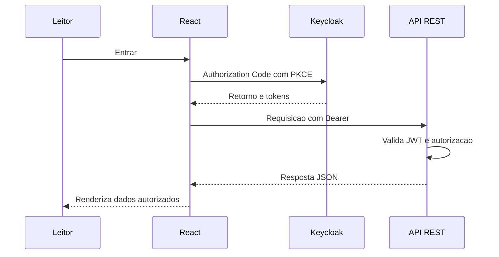

# Contexto técnico — frontend-keycloak-sessao

Trechos temáticos do README da main. Confira o código e o README vigente se o contrato tiver mudado.

### Fluxo de autenticação

### Autenticação e CORS

A gestão do acervo e o balcão exigem `BIBLIOTECARIO`; a administração de contas exige `ADMINISTRADOR`. A API é a autoridade final e valida cada operação; esconder um botão não substitui esse controle. O login usa um cliente público com PKCE, sem `client_secret`, e o token fica apenas em memória. `apiFetch` renova o token e impede enviá-lo para outra origem ou para fora do prefixo da API.

Em produção, frontend e APIs estão na mesma origem (`https://bibliogest.ksferreira.org`). Os prefixos de API `/acervo/api`, `/reservas/api` e `/usuarios/api` são roteados pelo Ingress. Por isso não é necessário abrir CORS nas APIs. No desenvolvimento normal, o proxy do Vite mantém as chamadas na origem local do frontend. O CORS do próprio Keycloak é configurado em **Web Origins** do cliente. Usar uma API, por si só, não dispensa CORS.

## Matriz de permissões

As roles são atribuídas no Keycloak e verificadas nas APIs. Uma conta pode acumular roles; ADMINISTRADOR por si só não equivale a LEITOR ou BIBLIOTECARIO.

| Operação | LEITOR | BIBLIOTECARIO | ADMINISTRADOR |
| --- | --- | --- | --- |
| Consultar catálogo e disponibilidade | Sim | Sim | Se também leitor/bibliotecário |
| Criar reserva pessoal | Sim | Se também leitor | Se também leitor |
| Consultar reservas próprias | Sim | Sim | Se também leitor/bibliotecário |
| Cancelar reserva aguardando retirada | Própria | Sim | Conforme outras roles |
| Consultar balcão, registrar retirada/devolução | Não | Sim | Se também bibliotecário |
| Cadastrar e editar acervo | Não | Sim | Se também bibliotecário |
| Administrar contas e consultar auditoria | Não | Não | Sim |

A ausência de autenticação válida leva a 401; uma role insuficiente leva a 403. Consultas a reservas de terceiros sem autorização devolvem 404 conforme o contrato. IDs técnicos identificam recursos; não substituem autorização.
