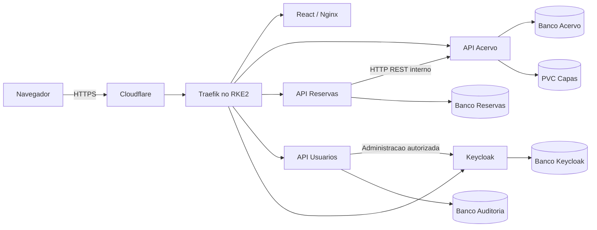

# Contexto técnico — frontend-nginx-deploy

Trechos temáticos do README da main. Confira o código e o README vigente se o contrato tiver mudado.

### CSP

`security-headers.conf` define um header **Content-Security-Policy em modo de bloqueio**, carregado pelo Nginx de produção. Não é apenas `Report-Only`. A política permite somente os recursos usados pelo site:

| Recurso | Origens permitidas |
| --- | --- |
| Scripts | O próprio site e o beacon externo `static.cloudflareinsights.com` |
| Estilos | O próprio site e `fonts.googleapis.com` |
| Fontes | O próprio site e `fonts.gstatic.com` |
| Imagens | O próprio site e URLs `data:` |
| Conexões | O próprio site, `login.ksferreira.org` e o endpoint de analytics `cloudflareinsights.com` |
| Formulários | O próprio site e o login do Keycloak |
| Frames, objetos e base HTML | Bloqueados |

`default-src 'none'` bloqueia o restante. Scripts inline, `eval` e origens com curingas não são liberados. `frame-ancestors 'none'` impede incorporar o site em outros sites; `upgrade-insecure-requests` solicita recursos por HTTPS. O Keycloak usa PKCE S256 e `checkLoginIframe: false`, portanto não depende de iframe de sessão. A imagem de fundo é um arquivo do próprio projeto.

A política é enviada também em `/config.json`, `/index.html` e `/assets/`, preservando os headers mesmo nas localidades do Nginx que definem cache. Ela entra em vigor quando a imagem Docker atualizada é publicada. O Vite de desenvolvimento usa HMR e não aplica esse header de produção.

Se mudar o domínio do Keycloak, fontes ou serviços externos, revise a lista antes de publicar. Verifique **Network → documento principal → Response Headers** e o console do navegador. Não resolva violações adicionando `*`, `unsafe-inline` ou `unsafe-eval`. A CSP reduz o impacto de injeções; autorização e validação de entrada continuam obrigatórias. Referência: [CSP no MDN](https://developer.mozilla.org/en-US/docs/Web/HTTP/Guides/CSP).

## Build e publicação

```bash
docker build -t bibliogest-frontend:0.2.0 .
```

O estágio final contém apenas o site compilado e a configuração do Nginx, executado como usuário 101 na porta 8080. `README.md`, `.env`, configurações locais e relatórios ficam fora do contexto Docker. O download do navegador Cypress é desativado durante a construção da imagem; os testes E2E são executados no job próprio do CI.

Em produção, `/config.json` é montado pelo ConfigMap `frontend-config` do RKE2. URLs de Keycloak e APIs são configuração pública. Senhas, tokens e chaves privadas não pertencem ao frontend. Os headers incluem ainda `nosniff`, política de referência, HSTS e bloqueio de frames. A CSP é definida no Nginx que entrega o HTML; os microsserviços retornam JSON e mantêm sua própria autorização.

## Arquitetura do BiblioGest

O BiblioGest é uma aplicação de gestão de bibliotecas baseada em microsserviços REST. Cada serviço tem uma responsabilidade e persistência próprias. O Keycloak centraliza identidade e autenticação; a integração entre serviços ocorre por HTTP, sem compartilhar entidades JPA ou consultar diretamente o banco de outro microsserviço.



Os bancos lógicos são independentes, hospedados na instância PostgreSQL do projeto. As capas ficam em volume persistente; o banco de Acervo guarda a referência. O ambiente usa Docker para construção de imagens, containerd e Kubernetes RKE2 para execução, Rancher para gerenciamento, Traefik para roteamento, Nginx para frontend e Cloudflare na borda. GitHub Actions executa validações e build; o deploy é uma operação separada. O pgAdmin é ferramenta de administração do banco, não parte do acesso do leitor.

| Componente | Responsabilidade | Repositório |
| --- | --- | --- |
| Frontend | Catálogo, reservas, balcão e administração | [bibliogest-frontend](https://github.com/ksferreira35/bibliogest-frontend) |
| Acervo | Obras, autores, categorias, exemplares e capas | [bibliogest-acervo](https://github.com/ksferreira35/bibliogest-acervo) |
| Reservas | Disponibilidade e circulação dos exemplares | [bibliogest-reservas](https://github.com/ksferreira35/bibliogest-reservas) |
| Usuários | Administração de contas e auditoria | [bibliogest-usuarios](https://github.com/ksferreira35/bibliogest-usuarios) |
