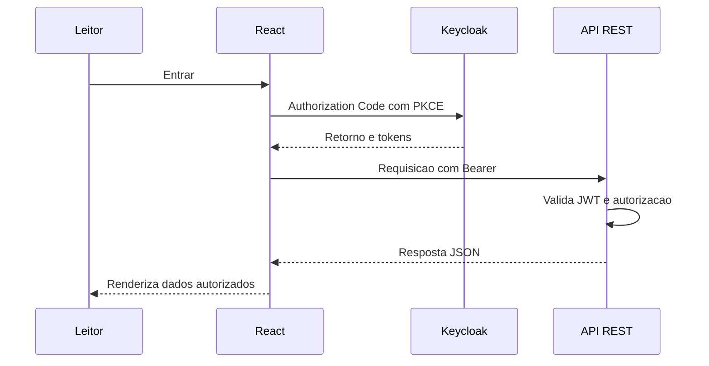

# Contexto técnico — frontend-react

Trechos temáticos do README da main. Confira o código e o README vigente se o contrato tiver mudado.

## Organização do frontend

| Tecnologia / arquivo | Função |
| --- | --- |
| React 19, JavaScript, Vite | Componentes e estado, build estático |
| Tailwind CSS 4 e Materialize CSS 2 | Layout responsivo e estilo dos componentes; CSS próprio para identidade CEUB |
| src/App.jsx, src/components/ | Áreas autenticadas, formulários, modais, catálogo e administração |
| src/domain/ | Transformação de dados de catálogo e reservas |
| src/auth.js, src/hooks/useSession.js | Sessão, autorização de apresentação, renovação e envio do token |
| public/config.json, config.dev.json | Configuração pública por ambiente |
| src/index.css, App.css, frameworks.css | Paleta, temas, acessibilidade e integração entre frameworks CSS |
| keycloak-theme/ | Tema de login independente, empacotado em JAR |
| nginx.conf, security-headers.conf | Servir SPA e políticas de cabeçalhos de produção |

O modo claro é padrão; `bibliogest-theme` salva apenas a preferência claro/escuro. `bibliogest-accessibility` guarda preferências de acessibilidade. O frontend não armazena o banco, senhas ou tokens de sessão no localStorage.

### Fluxo de autenticação

### Persistência e integração

O frontend não possui tabelas. Consulta as APIs por seus prefixos `/acervo/api/v1`, `/reservas/api/v1` e `/usuarios/api/v1`. Os esquemas PostgreSQL estão documentados nos três repositórios backend. O frontend não executa SQL; os controles de SQL Injection são responsabilidade dos repositories das APIs.

## Matriz de permissões

As roles são atribuídas no Keycloak e verificadas nas APIs. Uma conta pode acumular roles; ADMINISTRADOR por si só não equivale a LEITOR ou BIBLIOTECARIO.

| Operação | LEITOR | BIBLIOTECARIO | ADMINISTRADOR |
| --- | --- | --- | --- |
| Consultar catálogo e disponibilidade | Sim | Sim | Se também leitor/bibliotecário |
| Criar reserva pessoal | Sim | Se também leitor | Se também leitor |
| Consultar reservas próprias | Sim | Sim | Se também leitor/bibliotecário |
| Cancelar reserva aguardando retirada | Própria | Sim | Conforme outras roles |
| Consultar balcão, registrar retirada/devolução | Não | Sim | Se também bibliotecário |
| Cadastrar e editar acervo | Não | Sim | Se também bibliotecário |
| Administrar contas e consultar auditoria | Não | Não | Sim |

A ausência de autenticação válida leva a 401; uma role insuficiente leva a 403. Consultas a reservas de terceiros sem autorização devolvem 404 conforme o contrato. IDs técnicos identificam recursos; não substituem autorização.
