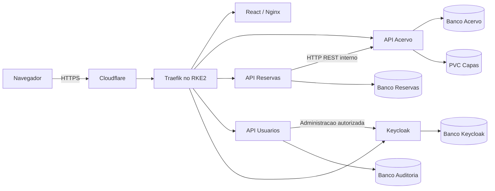
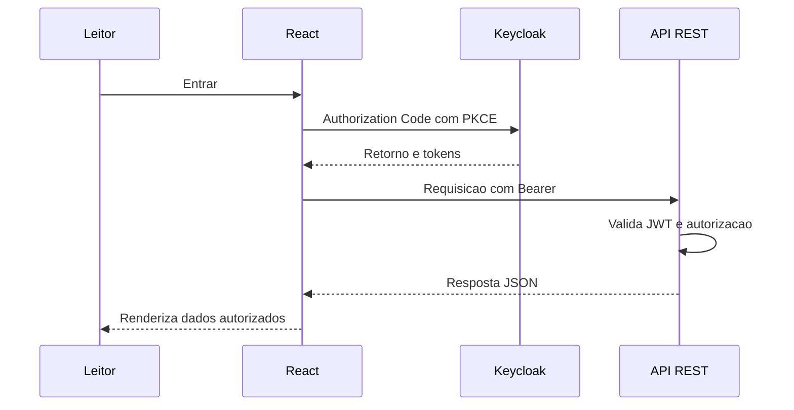

# BiblioGest — Frontend

Interface em React e Vite para leitores, bibliotecários e administradores. O catálogo, exemplares e circulação são carregados das APIs institucionais; não há backend ou catálogo local no frontend.

## Desenvolvimento local

Com Node.js 24 e npm instalados, na raiz do repositório:

```bash
npm ci
npm run dev
```

Abra [http://localhost:5173](http://localhost:5173/). O modo de desenvolvimento carrega `public/config.dev.json` e encaminha `/acervo` e `/reservas` para `https://bibliogest.ksferreira.org`, com `changeOrigin` habilitado. O login usa Keycloak com PKCE e mantém o access token em memória para as chamadas autenticadas.

No cliente `bibliogest-react` do realm `bibliogest`, permita `http://localhost:5173/*` em **Valid Redirect URIs** e `http://localhost:5173` em **Valid Post Logout Redirect URIs**. Configure **Web Origins** como `http://localhost:5173`. O endereço de retorno depois de sair está em `logoutRedirectUri` no `config.dev.json`.

`public/config.json` é a configuração padrão de produção e não contém endereço de Keycloak local nem segredo de cliente. Não coloque `client_secret` no frontend.

## Testes e cobertura

Use Node.js 24. Os testes não precisam de conta de produção, senha, token real ou banco de dados.

```bash
npm run lint
npm run test:coverage
npm run build
```

O Vitest executa testes de componentes, formulários, paginação, autenticação e permissões. O provider V8 mede todos os arquivos JavaScript/JSX de `src/`, incluindo a inicialização e os componentes sem teste direto. O comando falha se **qualquer uma** destas métricas ficar abaixo de 80%:

| Métrica | O que mede |
| --- | --- |
| Linhas | Linhas executáveis visitadas pelos testes |
| Statements | Instruções executadas |
| Funções | Funções chamadas |
| Branches | Alternativas percorridas em condições e decisões |

Abra `coverage/index.html` no navegador para consultar cada arquivo e as linhas que faltam testar. `coverage/lcov.info` permite integração com outros analisadores; `coverage/coverage-summary.json` contém os totais. Os relatórios são gerados localmente e ignorados pelo Git e pelo Docker. `npm test` roda a suíte sem medir cobertura; o CI usa `npm run test:coverage`.

80% de cobertura não significa 80% dos testes aprovados: todos os testes devem passar e o código executado precisa alcançar o mínimo em cada métrica. A configuração fica em `vitest.config.js`, sem excluir controllers de tela ou regras de acesso para elevar o percentual.

### Cypress: fluxos no navegador

O Cypress fica neste mesmo repositório. Em um terminal:

```bash
npm run dev:e2e
```

Em outro terminal:

```bash
npm run test:e2e -- --browser chrome --headless
```

Para abrir a interface interativa, use `npm run test:e2e:open`. O endereço de testes é `http://127.0.0.1:4173`. Instale o Chrome para o comando acima ou use o Electron incluído pelo Cypress (`npm run test:e2e`). No Linux, são necessárias as bibliotecas de navegador e um display ou Xvfb, conforme os [requisitos do Cypress](https://docs.cypress.io/app/get-started/install-cypress).

Os cenários de `cypress/e2e/bibliogest.cy.js` verificam entrada/saída, catálogo paginado, busca, sinopse, reserva, edição/exclusão pelo bibliotecário, ausência de comandos administrativos para o leitor e uso em tela pequena. `cypress-axe` verifica as regras automatizáveis WCAG 2 A/AA e 2.1 AA nas telas e diálogos visitados, sem ignorar violações para fazer o teste passar.

O servidor de testes substitui **somente nesse modo** o adapter do Keycloak por `cypress/support/keycloak.js`. As requisições são interceptadas pelo Cypress e recebem fixtures. Isso permite testar o frontend sem enviar dados ou credenciais à produção. O servidor E2E não tem proxy para as APIs reais. O build normal usa o Keycloak verdadeiro, e `vite build --mode e2e` é recusado. O adapter de teste não valida assinaturas JWT; essa responsabilidade é do backend e tem testes nos repositórios das APIs.

### CI no GitHub Actions

O workflow `.github/workflows/ci.yml` roda em pushes para `main`, branches `feature/**` e `fix/**`, além de pull requests destinados à `main`:

```text
lint → testes + cobertura → Cypress + axe → build
```

Cada job usa `needs` para só começar após o anterior passar. Uma falha interrompe as etapas seguintes. Não há conta de produção nem segredo de Keycloak no workflow. A tabela de cobertura aparece no resumo da execução. O relatório HTML pode ser baixado em **Artifacts → frontend-coverage**, inclusive quando o limite reprovar. Capturas de falhas do Cypress ficam no artefato `cypress-screenshots`. A retenção é de 14 dias.

## Acessibilidade

O botão **Acessibilidade**, disponível também antes de entrar, abre os controles próprios do BiblioGest:

- Texto padrão, ampliado (112,5%) ou maior (125%); medidas tipográficas em `rem` acompanham a escolha. O zoom do navegador continua disponível.
- Alto contraste e redução de movimento. A preferência do sistema `prefers-reduced-motion` também é respeitada.
- Restauração das preferências. Essas escolhas são salvas no `localStorage`, na chave `bibliogest-accessibility`; a preferência de tema usa `bibliogest-theme`. Nenhum token é salvo ali.

O link **Pular para o conteúdo** aparece ao receber foco pelo teclado. Os controles têm identificação acessível e foco visível. Todos os diálogos usam `Modal.jsx`: recebem foco ao abrir, mantêm Tab/Shift+Tab dentro da janela, tornam o fundo inativo, fecham com Escape e devolvem o foco ao acionador quando ele ainda existe. Uma operação de gravação em andamento pode impedir o fechamento por Escape para não ocultar seu resultado.

Os componentes ficam em `src/components/Accessibility.jsx` e `Modal.jsx`; estilos e preferências visuais em `src/index.css` e `src/App.css`. A suíte automatizada não substitui a revisão manual com teclado, zoom e leitor de tela. Estes controles não incluem tradução para Libras nem o serviço comercial Rybená.

## Segurança no navegador

### CSP

`security-headers.conf` define um header **Content-Security-Policy em modo de bloqueio**, carregado pelo Nginx de produção. Não é apenas `Report-Only`. A política permite somente os recursos usados pelo site:

| Recurso | Origens permitidas |
| --- | --- |
| Scripts | O próprio site e o beacon externo `static.cloudflareinsights.com` |
| Estilos | O próprio site e `fonts.googleapis.com` |
| Fontes | O próprio site e `fonts.gstatic.com` |
| Imagens | O próprio site e URLs `data:` |
| Conexões | O próprio site, `login.ksferreira.org` e o endpoint de analytics `cloudflareinsights.com` |
| Formulários | O próprio site e o login do Keycloak |
| Frames, objetos e base HTML | Bloqueados |

`default-src 'none'` bloqueia o restante. Scripts inline, `eval` e origens com curingas não são liberados. `frame-ancestors 'none'` impede incorporar o site em outros sites; `upgrade-insecure-requests` solicita recursos por HTTPS. O Keycloak usa PKCE S256 e `checkLoginIframe: false`, portanto não depende de iframe de sessão. A imagem de fundo é um arquivo do próprio projeto.

A política é enviada também em `/config.json`, `/index.html` e `/assets/`, preservando os headers mesmo nas localidades do Nginx que definem cache. Ela entra em vigor quando a imagem Docker atualizada é publicada. O Vite de desenvolvimento usa HMR e não aplica esse header de produção.

Se mudar o domínio do Keycloak, fontes ou serviços externos, revise a lista antes de publicar. Verifique **Network → documento principal → Response Headers** e o console do navegador. Não resolva violações adicionando `*`, `unsafe-inline` ou `unsafe-eval`. A CSP reduz o impacto de injeções; autorização e validação de entrada continuam obrigatórias. Referência: [CSP no MDN](https://developer.mozilla.org/en-US/docs/Web/HTTP/Guides/CSP).

### Autenticação e CORS

A gestão do acervo e o balcão exigem `BIBLIOTECARIO`; a administração de contas exige `ADMINISTRADOR`. A API é a autoridade final e valida cada operação; esconder um botão não substitui esse controle. O login usa um cliente público com PKCE, sem `client_secret`, e o token fica apenas em memória. `apiFetch` renova o token e impede enviá-lo para outra origem ou para fora do prefixo da API.

Em produção, frontend e APIs estão na mesma origem (`https://bibliogest.ksferreira.org`). Os prefixos de API `/acervo/api`, `/reservas/api` e `/usuarios/api` são roteados pelo Ingress. Por isso não é necessário abrir CORS nas APIs. No desenvolvimento normal, o proxy do Vite mantém as chamadas na origem local do frontend. O CORS do próprio Keycloak é configurado em **Web Origins** do cliente. Usar uma API, por si só, não dispensa CORS.

## Build e publicação

```bash
docker build -t bibliogest-frontend:0.2.0 .
```

O estágio final contém apenas o site compilado e a configuração do Nginx, executado como usuário 101 na porta 8080. `README.md`, `.env`, configurações locais e relatórios ficam fora do contexto Docker. O download do navegador Cypress é desativado durante a construção da imagem; os testes E2E são executados no job próprio do CI.

Em produção, `/config.json` é montado pelo ConfigMap `frontend-config` do RKE2. URLs de Keycloak e APIs são configuração pública. Senhas, tokens e chaves privadas não pertencem ao frontend. Os headers incluem ainda `nosniff`, política de referência, HSTS e bloqueio de frames. A CSP é definida no Nginx que entrega o HTML; os microsserviços retornam JSON e mantêm sua própria autorização.

## Solicitante nas reservas

O balcão e o detalhe mostram `leitorNome`, retornado pela API de Reservas, inclusive quando o bibliotecário está vendo a reserva de outra pessoa. O nome do usuário logado só serve de alternativa quando o `leitorId` da reserva corresponde ao `sub` da própria sessão. O UUID do usuário não é mostrado como nome nem como campo de identificação na tela.

Para registros antigos sem nome, aparece **Nome não informado**, sem inventar a identidade ou substituir pelo nome do bibliotecário. A API grava o nome vindo do token validado no momento da solicitação. O ID continua no contrato da API e nas verificações de propriedade; não é segredo nem substitui autorização. Os nomes são renderizados como texto pelo React.

## Administração de contas

A aba **Usuários** aparece somente para ADMINISTRADOR. A role não implica BIBLIOTECARIO: uma conta administrativa sem esse perfil não recebe gestão do acervo nem balcão. O painel lista/pesquisa contas, cria leitores com senha temporária, promove/remove BIBLIOTECARIO, ativa/desativa contas, encerra sessões e consulta auditoria. Alterações exigem confirmação. A própria conta e contas protegidas não recebem esses comandos.

O frontend chama `usuariosUrl` em `/config.json` (produção) ou `/config.dev.json` (desenvolvimento), normalmente `/usuarios/api`. O client secret do serviço não pertence a esses arquivos. A API valida a role e a audiência independentemente da tela. Uma mudança de role remonta a área de trabalho, removendo o painel da sessão que perdeu a permissão.

A senha de criação fica apenas no estado temporário do formulário e é limpa ao fechar ou concluir. A conta inicia como LEITOR e troca a senha no primeiro acesso. JWTs já emitidos podem durar até expirar mesmo após encerrar sessões no Keycloak. Os testes Cypress usam fixtures, sem alterar contas reais.

No modo de desenvolvimento, o proxy de `/usuarios` aponta para a API local em `127.0.0.1:8082`, evitando administrar contas reais por acidente durante o desenvolvimento do painel. Os proxies legados de Acervo e Reservas mantêm sua configuração anterior. Para testes automatizados, o modo E2E não encaminha requisições às APIs reais.

## Edição acadêmica CEUB

A branch `feature/identidade-ceub` conserva a navegação, a integração com as três APIs e os controles de acessibilidade. A identidade usa roxo, magenta e o logo fornecido para o projeto. A revisão de portfólio permanece em `feature/administracao-usuarios` (`5ac7b90`).

- Tailwind CSS 4: integração pelo plugin oficial do Vite, com classes utilitárias de layout, grade de livros e espaçamento; sem Preflight.
- Materialize CSS 2: botões preenchidos, contornados e tonais, cartões e tokens visuais. Seu CSS fica numa camada própria; os formulários, os diálogos acessíveis e os eventos continuam controlados pelo React.
- CSS do projeto: identidade CEUB, paleta, contraste, estilização das telas e adaptações responsivas. Sem Bootstrap.

O tema separado do Keycloak está em `keycloak-theme/`. Empacote o diretório como JAR mantendo `META-INF/keycloak-themes.json` e `theme/bibliogest-ceub` na raiz e disponibilize-o em `/opt/keycloak/providers/`. Depois de reiniciar o Keycloak, selecione **Realm settings → Themes → Login theme → bibliogest-ceub**. O tema original `bibliogest` permanece disponível. O novo tema altera apenas CSS e recursos de apresentação; herda os formulários e o fluxo de autenticação de `keycloak.v2`.

O fluxo de CI continua executando lint, Vitest com mínimo de 80% em todas as métricas, Cypress (incluindo verificações de acessibilidade) e build.

## Arquitetura do BiblioGest

O BiblioGest é uma aplicação de gestão de bibliotecas baseada em microsserviços REST. Cada serviço tem uma responsabilidade e persistência próprias. O Keycloak centraliza identidade e autenticação; a integração entre serviços ocorre por HTTP, sem compartilhar entidades JPA ou consultar diretamente o banco de outro microsserviço.



Os bancos lógicos são independentes, hospedados na instância PostgreSQL do projeto. As capas ficam em volume persistente; o banco de Acervo guarda a referência. O ambiente usa Docker para construção de imagens, containerd e Kubernetes RKE2 para execução, Rancher para gerenciamento, Traefik para roteamento, Nginx para frontend e Cloudflare na borda. GitHub Actions executa validações e build; o deploy é uma operação separada. O pgAdmin é ferramenta de administração do banco, não parte do acesso do leitor.

| Componente | Responsabilidade | Repositório |
| --- | --- | --- |
| Frontend | Catálogo, reservas, balcão e administração | [bibliogest-frontend](https://github.com/ksferreira35/bibliogest-frontend) |
| Acervo | Obras, autores, categorias, exemplares e capas | [bibliogest-acervo](https://github.com/ksferreira35/bibliogest-acervo) |
| Reservas | Disponibilidade e circulação dos exemplares | [bibliogest-reservas](https://github.com/ksferreira35/bibliogest-reservas) |
| Usuários | Administração de contas e auditoria | [bibliogest-usuarios](https://github.com/ksferreira35/bibliogest-usuarios) |

## Organização do frontend

| Tecnologia / arquivo | Função |
| --- | --- |
| React 19, JavaScript, Vite | Componentes e estado, build estático |
| Tailwind CSS 4 e Materialize CSS 2 | Layout responsivo e estilo dos componentes; CSS próprio para identidade CEUB |
| src/App.jsx, src/components/ | Áreas autenticadas, formulários, modais, catálogo e administração |
| src/domain/ | Transformação de dados de catálogo e reservas |
| src/auth.js, src/hooks/useSession.js | Sessão, autorização de apresentação, renovação e envio do token |
| public/config.json, config.dev.json | Configuração pública por ambiente |
| src/index.css, App.css, frameworks.css | Paleta, temas, acessibilidade e integração entre frameworks CSS |
| keycloak-theme/ | Tema de login independente, empacotado em JAR |
| nginx.conf, security-headers.conf | Servir SPA e políticas de cabeçalhos de produção |

O modo claro é padrão; `bibliogest-theme` salva apenas a preferência claro/escuro. `bibliogest-accessibility` guarda preferências de acessibilidade. O frontend não armazena o banco, senhas ou tokens de sessão no localStorage.

### Fluxo de autenticação



### Persistência e integração

O frontend não possui tabelas. Consulta as APIs por seus prefixos `/acervo/api/v1`, `/reservas/api/v1` e `/usuarios/api/v1`. Os esquemas PostgreSQL estão documentados nos três repositórios backend. O frontend não executa SQL; os controles de SQL Injection são responsabilidade dos repositories das APIs.

## Matriz de permissões

As roles são atribuídas no Keycloak e verificadas nas APIs. Uma conta pode acumular roles; ADMINISTRADOR por si só não equivale a LEITOR ou BIBLIOTECARIO.

| Operação | LEITOR | BIBLIOTECARIO | ADMINISTRADOR |
| --- | --- | --- | --- |
| Consultar catálogo e disponibilidade | Sim | Sim | Se também leitor/bibliotecário |
| Criar reserva pessoal | Sim | Se também leitor | Se também leitor |
| Consultar reservas próprias | Sim | Sim | Se também leitor/bibliotecário |
| Cancelar reserva aguardando retirada | Própria | Sim | Conforme outras roles |
| Consultar balcão, registrar retirada/devolução | Não | Sim | Se também bibliotecário |
| Cadastrar e editar acervo | Não | Sim | Se também bibliotecário |
| Administrar contas e consultar auditoria | Não | Não | Sim |

A ausência de autenticação válida leva a 401; uma role insuficiente leva a 403. Consultas a reservas de terceiros sem autorização devolvem 404 conforme o contrato. IDs técnicos identificam recursos; não substituem autorização.

## Segurança em camadas

| Controle | Implementação e finalidade |
| --- | --- |
| Autenticação | Keycloak, OAuth 2.0/OIDC, PKCE S256 no frontend; tokens JWT Bearer nas APIs. |
| Autorização | Spring Security verifica assinatura, emissor, audiência e expiração; roles e propriedade dos recursos são avaliadas no backend. |
| SQL Injection | Dados de entrada são tratados como valores tipados em consultas parametrizadas nos repositories, não como trechos de SQL. Validação de entrada complementa essa proteção. |
| XSS | React renderiza conteúdo textual com escape; CSP no Nginx limita recursos autorizados no navegador. |
| CSRF | As APIs são stateless e autorizam via Bearer explícito, não por cookie de sessão enviado automaticamente. CSRF do Spring está desativado para esse modelo. Isso não elimina os controles do Keycloak no login. |
| CORS | APIs e frontend usam a mesma origem pública; os caminhos são roteados pelo Ingress. Vite usa proxy no desenvolvimento. Web Origins do Keycloak é configurado no cliente, sem liberação genérica. CORS não substitui autenticação. |
| Clickjacking | Nginx envia X-Frame-Options DENY e CSP frame-ancestors none. |
| Transporte | HTTPS público, HSTS no frontend e Cloudflare na borda. |
| Segredos e rede | Credenciais via ambiente/Secrets, banco e serviços internos com escopo de rede e contas separadas. Swagger fica desabilitado em produção. |

Esses controles reduzem riscos, mas não constituem certificação de ausência de vulnerabilidades. O projeto mantém testes defensivos, validação e revisão dos contratos. Não use produção nem credenciais reais em testes automatizados.

## Skills para agentes de IA
As skills estão em `.agents/skills/`. Cada pasta contém um `SKILL.md` com contexto, regras e orientação de manutenção. São instruções de desenvolvimento para agentes, não funcionalidades de IA em execução no sistema.

| Skill | Finalidade |
| --- | --- |
| [frontend-acessibilidade](.agents/skills/frontend-acessibilidade/SKILL.md) | Revisar acessibilidade, teclado, foco dos diálogos, contraste e redução de movimento. |
| [frontend-design-css](.agents/skills/frontend-design-css/SKILL.md) | Modificar identidade CEUB, layouts responsivos, temas claro/escuro e componentes visuais com Tailwind e Materialize. |
| [frontend-integracao-rest](.agents/skills/frontend-integracao-rest/SKILL.md) | Integrar as telas com as APIs REST de Acervo, Reservas e Usuários e seus contratos. |
| [frontend-keycloak-sessao](.agents/skills/frontend-keycloak-sessao/SKILL.md) | Manter login OIDC, renovação, logout, visibilidade por roles e preferências de sessão no React. |
| [frontend-nginx-deploy](.agents/skills/frontend-nginx-deploy/SKILL.md) | Manter build Docker, Nginx, CSP, configuração pública e integração de deploy frontend no Kubernetes. |
| [frontend-react](.agents/skills/frontend-react/SKILL.md) | Implementar telas, componentes e estado do frontend React do BiblioGest. |
| [frontend-testes-ci](.agents/skills/frontend-testes-ci/SKILL.md) | Executar e ampliar testes React, Vitest, Cypress, axe-core, Oxlint e pipeline GitHub Actions. |
